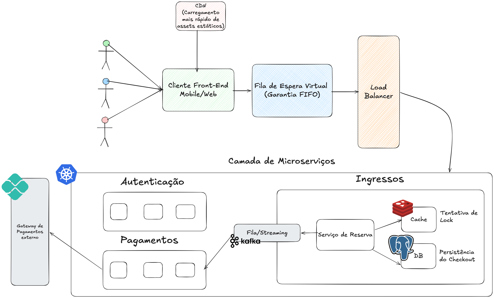

# Sistema de Venda de Ingressos de Alta Concorrência (Rock in Rio)

Este repositório contém a documentação da arquitetura de software projetada para suportar um sistema de venda de ingressos para megaeventos de altíssima demanda e concorrência. O objetivo principal do design é garantir a **justiça no acesso** (impedindo que a latência da rede beneficie conexões mais rápidas) e **evitar o overbooking** (garantindo consistência absoluta do estoque).

## 🗺️ Visão Geral da Arquitetura

O diagrama abaixo ilustra o fluxo de dados e a segregação de responsabilidades entre as camadas do sistema, desde o acesso do usuário até a persistência final da compra.

---

## 🏗️ Componentes do Sistema

A arquitetura está dividida logicamente em três grandes blocos: **Camada de Borda/Entrada**, **Camada de Microsserviços (Kubernetes)** e **Camada de Dados/Persistência**.

### 1. Camada de Borda e Entrada
*   **Atores (Clientes):** Usuários tentando acessar o sistema simultaneamente via plataformas Mobile ou Web.
*   **CDN (Content Delivery Network):** Responsável pelo carregamento rápido de assets estáticos (HTML, CSS, JS, imagens), diminuindo a carga direta nos servidores internos.
*   **Fila de Espera Virtual (Garantia FIFO):** O coração da justiça do sistema. Transforma o tráfego caótico em uma fila ordenada por ordem de chegada (*First-In, First-Out*). O token de posição é gerado no servidor, neutralizando a vantagem de usuários com conexões de internet ultrarrápidas.
*   **Load Balancer:** Distribui o tráfego filtrado e autorizado da fila de espera entre as réplicas da camada de microsserviços.

### 2. Camada de Microsserviços (Orquestrada via Kubernetes)
Toda a lógica de negócios roda dentro de um cluster orquestrado por **Kubernetes (K8s)**, permitindo escalabilidade elástica dos containers de acordo com a demanda:

*   **Autenticação:** Módulo responsável por garantir a identidade e sessão dos usuários liberados pela fila.
*   **Ingressos (Serviço de Reserva):** Gerencia a disponibilidade de assentos. Quando um usuário tenta comprar, o serviço realiza uma **Tentativa de Lock** rápida no cache em memória.
*   **Fila/Streaming (Apache Kafka):** Atua como o motor de mensageria assíncrona. Quando uma reserva temporária é feita com sucesso, o evento é postado no Kafka para que o serviço de pagamentos o processe sem travar a experiência do usuário.
*   **Pagamentos:** Consome as mensagens do Kafka para processar as transações financeiras individualmente, fazendo a ponte com o **Gateway de Pagamentos Externo**.

### 3. Camada de Dados e Persistência
O sistema adota uma estratégia híbrida de banco de dados para separar velocidade de consistência:

*   **Cache (Redis):** Utilizado para operações de altíssima velocidade. Armazena os contadores de ingressos e gerencia os *Distributed Locks* temporários (ex: reserva garantida por 10 minutos enquanto o usuário preenche os dados de pagamento).
*   **DB (Banco de Dados Relacional - PostgreSQL):** Atua como a **Fonte Única da Verdade**. Armazena os dados transacionais de forma permanente, registrando a persistência do checkout, a titularidade do ingresso e o histórico financeiro com garantia ACID absoluta.

---

## 🔄 Fluxo de Uma Compra Bem-Sucedida

1. O **Cliente** acessa o site e é retido na **Fila de Espera Virtual** onde ganha uma posição justa.
2. Ao chegar sua vez, o **Load Balancer** o direciona para o microsserviço de **Ingressos**.
3. O cliente escolhe o ingresso e o **Serviço de Reserva** faz um decremento atômico e cria um *Lock* temporário no **Cache (Redis)**. O ingresso sai do estoque geral por 10 minutos.
4. O evento de checkout é enviado para o **Apache Kafka**.
5. O microsserviço de **Pagamentos** consome o evento e realiza a cobrança através do **Gateway de Pagamento Externo**.
6. Com o pagamento aprovado, os dados da compra e o ingresso são gravados permanentemente no **Banco de Dados (DB)**.

---

## 🚨 Cenários de Exceção (Resiliência)

*   **Tempo de Pagamento Expirado (Timeout):** Se o usuário não concluir o pagamento em até 10 minutos, o *Lock* no Redis expira e o microsserviço devolve o ingresso (+1) para o estoque do Cache automaticamente.
*   **Falha no Cartão/Pix:** Caso o Gateway Externo recuse a transação, a mensagem de falha é processada, a persistência no banco de dados registra a tentativa cancelada e o ingresso é liberado imediatamente na fila do Kafka para o próximo cliente.
